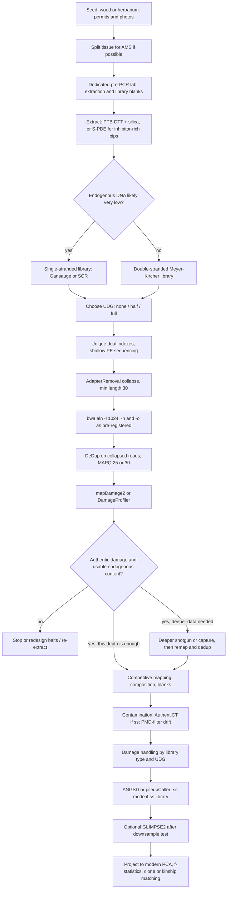

# Workflow - grapevine-adna

This page is the decision tree from archaeological or herbarium material to a genotype that can enter vitis-popgen. It complements, and does not overwrite, the scripts already on `main`.

## Default route

## Decision points

<!-- PROSE:WORKFLOW_DECISIONS -->
1. Prioritise seeds; record context, permits, and whether a sister seed or a split pip was dated. Explicitly note that the tissue origin of DNA in published archaeological pips has not been directly verified. A seed comprises maternal seed-coat tissue (sharing the mother plant's genotype, and thus the cultivar clone), a sexual embryo, and triploid endosperm containing two maternal genomes and one paternal genome in the common angiosperm case [待确认]. Li and Berger 2012 (doi:10.1111/j.1469-8137.2012.04182.x) provides a general review of endosperm development. Interpreting a result as the "same clone as a living cultivar" is straightforward only if the recovered DNA predominantly represents maternal tissue; if it predominantly represents the embryo, the expected relationship is parent-offspring. The embryo develops from the L2 layer [待确认], whereas whether seed-coat DNA is predominantly L1-derived remains [待确认]. Layer-specific somatic variants in chimeric cultivars must not be used as diagnostic sites for a same-clone call. Where high-depth data are available, pre-register a mixture test. A seed-coat plus embryo mixture involves two diploid genotypes with maternal fraction m; expected minor-allele fractions vary continuously with m, and a 1/3 peak represents only the special case of pure endosperm. When endosperm DNA is also present, the seed remains a mixture of maternal and paternally derived haplotypes, but a single parameter m no longer represents the seed-coat fraction, requiring a two-parameter, three-haplotype model. Triallelic sites serve only as an auxiliary indicator. Allele ratios alone cannot identify which component is maternal, nor can they distinguish a tissue mixture from present-day contamination. Separating these alternatives relies primarily on damage-stratified analysis (testing whether the minor genotype persists in reads carrying terminal C-to-T substitutions) and fragment-length distributions. A parent-offspring check can exclude only an unrelated modern contaminant; it cannot rule out contamination from a related living cultivar, and the constraint must accommodate selfing (where the pollen parent is the same plant as the seed parent). Design note, with all numerical thresholds left [待确认]: restrict the primary analysis to transversion sites; compare a single-genotype model, an unconstrained mixture, and a parent-offspring-constrained mixture (including selfing) via a likelihood-ratio test with parametric bootstrap; rely on damage-stratified or PMD reads and fragment lengths as the primary evidence separating tissue mixture from contamination; complete simulated negative and positive controls (including selfing and related-cultivar contamination scenarios) and lock all thresholds before inspecting any ancient data. Do not invent numerical thresholds here.
2. In a viticulture institute, treat modern grape DNA—not just human DNA—as the primary contamination hazard. Seeds from the same archaeological unit, or even the same bunch, may be full or half siblings; assess relatedness and prune or model it prior to estimating allele frequencies, PCA, or f-statistics, following the modern-sample workflow.
3. Evaluate extraction methods in a pilot comparison (PTB-DTT versus the 2025 S-PDE grape-pip protocol) rather than standardising from one paper.
4. Use single-stranded libraries when endogenous DNA content is low (Gansauge ssDNA methods). Do not cite the Ramos-Madrigal 2026 review to justify this choice unless the full text has been verified [待确认].
5. Default alignment uses bwa aln. Record parameters and their sources separately, and copy existing repository scripts verbatim rather than blending them with literature settings. `-l 1024` disables seeding on Illumina data (Schubert et al. 2012), while Schubert retained the default `-n` of 0.04 for Illumina. The parameter combination `-n 0.01 -o 2` is widespread in ancient human studies (often paired with `-l 16500`) and is cited by Dolenz et al. 2024 as originating from Green et al. 2010; the original source remains [待确认]. `-l 1024 -i 0 -o 2 -n 0.03` is the Helicos configuration in Schubert 2012, not the Illumina setting. This catalogue retains bwa aln as the default for short, damaged reads. Oliva et al. 2021 benchmarked parameterised BWA-aln, BWA-mem, and NovoAlign on simulated human reads without identifying a single preferred aligner. The default minimum collapsed read length is 30 bp, with 25 bp used solely for sensitivity analyses. For collapsed single-end reads, DeDup is the default duplicate marker because it evaluates both read endpoints, whereas Picard MarkDuplicates checks only the 5-prime coordinate and can over-remove reads. Report the MAPQ cutoff (25 or 30).
6. Following damage profiling, mitigate residual damage according to library type and UDG treatment before genotyping. This applies to both screening data and deeper shotgun or capture data; after deeper sequencing, re-map and deduplicate before damage mitigation and genotyping. Double-stranded libraries typically show C-to-T at the 5-prime end and G-to-A at the 3-prime end; single-stranded libraries show C-to-T at both ends; and UDG-half treatment typically leaves residual damage in the terminal one or two bases. Defaults: trim terminal bases (e.g., trimBam, 2 nt from each end for UDG-half; more for non-UDG, or restricting downstream calls to transversions), rescaling base qualities with mapDamage2, or filtering reads with PMDtools. For single-stranded libraries, run pileupCaller with `--singleStrandMode`. Because full UDG treatment does not remove thymines arising from deamination of methylated cytosines in plant CG, CHG, or CHH contexts, residual C-to-T transitions at these sites still require caution.
7. Disable or ignore human X-chromosome contamination modules in nf-core/eager, including hapCon, which requires a male X chromosome and is inapplicable to grape. AuthentiCT applies solely to single-stranded libraries and must not be run on UDG-treated or PMD-filtered data. Version 2.5.3 is the latest nf-core/eager release (3.0 has not been released), and Nextflow must be <=22.10.6. Compare sample positions in PCA or f-statistics before and after PMD filtering as a plant-applicable contamination check. Sequence the blanks.
8. Genotype imputation is permitted only after a pre-registered accuracy benchmark on modern grapes downsampled to ancient depths (AM17, project 20). Prefer random read draws or genotype likelihoods over majority calls at low coverage. Pseudo-haploid calls discard within-individual heterozygosity and must not be used as a direct heterozygosity estimate.
9. Any match to a living cultivar is a hypothesis, and reporting must distinguish a same-clone match from a first-degree relationship. Both interpretations also rest on the unverified tissue-origin assumption noted in point 1, while modern contamination remains an alternative explanation. Require blanks, damage and independent evidence. If an ancient pip belongs to the same clone as a living cultivar, molecular tip-dating captures virtually no branch length, as tip dates reflect the seed's death date, which may postdate the clone's origin by centuries. Use low-coverage kinship tools (READv2, KIN, BREADR, or ngsRelate) calibrated on modern clone and relative pairs downsampled to matching depth rather than KING hard-call cutoffs. Finally, hapROH and hapCon are human-specific tools and must not be presented as clonal-history methods or ready-to-use grape tools.
<!-- /PROSE:WORKFLOW_DECISIONS -->

Existing repository scripts already implement a mapping and damage-profiling batch for a capture test. This catalogue does not modify them. If a published parameter string is compared with those scripts, quote the script values verbatim.

Versions of the named tools are in the main catalogue, checked on 2026-11-14, Asia/Shanghai (CST, UTC+8).
