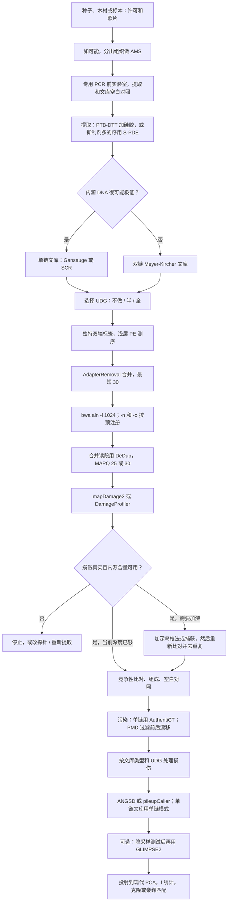

# 流程 - grapevine-adna

本页是从考古或标本馆材料到可进入 vitis-popgen 的基因型的决策树。它补充、但不覆盖 `main` 上已有的脚本。

## 默认路线

## 决策点

<!-- PROSE:WORKFLOW_DECISIONS -->
1. 优先选用种子作为研究材料；详细记录考古层位、采样许可，以及是否使用了姊妹籽或同一粒种子的半粒进行测年。需明确注明：已发表的考古葡萄籽中，所测 DNA 具体来源于哪种组织尚未得到直接验证。一粒种子包含母本种皮组织（基因型与母株一致，即对应品种的克隆）、有性胚，以及在被子植物常见情况下含两份母本基因组和一份父本基因组的三倍体胚乳 [待确认]。Li 和 Berger 2012（doi:10.1111/j.1469-8137.2012.04182.x）是一篇关于胚乳发育的综述。唯有当测序数据主要来源于母本组织时，“与现存品种为同一克隆”的推断才较为直接；若数据主要来源于胚，预期亲缘关系则应为亲子关系。胚由 L2 层发育而来 [待确认]，而种皮 DNA 是否主要来源于 L1 仍为 [待确认]。周缘嵌合品种中的层特异体细胞变异，不可用作判定同一克隆的关键位点。若具备高深度测序数据，应预先登记一项混合检验。种皮与胚的混合本质上是两个二倍体基因型的混合（母本占比记为 m），次要等位基因的预期比例随 m 连续变化，而 1/3 峰仅为纯胚乳的特例。若同时混有胚乳 DNA，该种子在单倍型层面仍为母本与父本来源单倍型的混合，但单一参数 m 不再等同于种皮占比，此时需采用两参数的三单倍型模型。三等位位点仅作为辅助判别指标。单凭等位基因比例既无法判断哪一组分为母本，也无法区分组织混合与现代污染。区分二者的主要证据在于按损伤分层的分析（即仅保留末端携带 C→T 替换的读段时，次要基因型是否依然存在）以及 DNA 片段长度分布。亲子关系检验只能排除无关的现代污染，无法排除来自亲缘品种的污染，且亲子模型约束必须涵盖自交情形（即父本与母本为同一植株）。设计说明（所有数值阈值仍为 [待确认]）：主分析仅采用颠换位点；利用似然比检验结合参数自助法，比较单一基因型、无约束混合及亲子约束混合（含自交）三种模型；在区分组织混合与外源污染时，应以损伤分层读段或 PMD 读段及片段长度作为主要证据；在接触任何古代样本数据之前，必须先完成阴性与阳性模拟对照测试（涵盖自交情景及亲缘品种污染）并锁定全部判别阈值。此处不编造这些数字。
2. 在葡萄研究机构中，现代葡萄 DNA 应被视为首要污染风险，而不仅限于人类 DNA 污染。同一考古单元乃至同一果穗上的种子可能是同胞或半同胞；在计算等位基因频率、开展 PCA 或 f 统计分析前，需先评估亲缘关系，并参照现代样本流程进行剔除或纳入模型。
3. DNA 提取方法应先通过预试验进行横向比较（PTB-DTT 法对比 2025 年葡萄种子 S-PDE 方案），切勿仅依据单一文献直接确定标准流程。
4. 当内源 DNA 含量较低时，采用单链建库法（Gansauge 的 ssDNA 建库技术）。在核实 Ramos-Madrigal 2026 综述全文之前，不要用该综述作为这一选择的依据 [待确认]。
5. 默认序列比对工具为 bwa aln。各项参数及出处须分开写明，仓库现有脚本中的参数应逐字照录，切勿与文献参数混杂。`-l 1024` 用于在 Illumina 数据中关闭 seed（Schubert 等 2012），而 Schubert 对 Illumina 数据保留了默认的 `-n` 0.04。`-n 0.01 -o 2` 这一参数组合在古人类研究中较为常见（常与 `-l 16500` 联用），Dolenz 等 2024 将其出处引为 Green 等 2010，但其原始出处仍为 [待确认]。`-l 1024 -i 0 -o 2 -n 0.03` 是 Schubert 2012 针对 Helicos 平台的设置，并非适用于 Illumina 平台。本目录针对短的损伤读段仍默认采用 bwa aln。Oliva 等 2021 在模拟人类读段上对比了特定参数下的 BWA-aln、BWA-mem 和 NovoAlign，并未确立单一的首选比对软件。合并后读段的默认最短长度为 30 bp，25 bp 仅用于敏感性分析。针对合并后的单端读段，默认使用 DeDup 去除重复，因其同时比对读段两端坐标；Picard MarkDuplicates 仅依据 5 端坐标判断，容易过度剔除有效读段。分析时须报告所使用的 MAPQ 阈值（25 或 30）。
6. 完成损伤谱鉴定后、进行基因分型前，须根据文库类型和 UDG 处理方式处理残留损伤。该步骤同时适用于初步筛查数据及后续加深的鸟枪法或捕获测序数据；深度测序后，应重新执行比对和去重复，再进行损伤处理与基因分型。双链文库通常在 5 端呈现 C→T、3 端呈现 G→A；单链文库两端均呈现 C→T；UDG-half 处理通常在末端一两个碱基留下残留损伤。默认处理方式包括：修剪末端碱基（如使用 trimBam，UDG-half 每端修剪 2 nt；未经 UDG 处理则需修剪更多碱基，或在下游分析中仅保留颠换位点）、使用 mapDamage2 重标碱基质量值，或使用 PMDtools 过滤读段。单链文库运行 pileupCaller 时应添加 `--singleStrandMode`。由于完全 UDG 处理无法去除植物 CG、CHG 或 CHH 位点上甲基化胞嘧啶脱氨产生的胸腺嘧啶（T），这些位点上残留的 C→T 信号仍需谨慎对待。
7. 关闭或忽略 nf-core/eager 中依赖人类 X 染色体的污染评估模块，包括 hapCon——该工具依赖男性 X 染色体，不适用于葡萄。AuthentiCT 仅适用于单链文库，不能用于经过 UDG 处理或 PMD 过滤的数据。nf-core/eager 的最新发行版是 2.5.3，3.0 版本尚未发布，且 Nextflow 版本不得高于 22.10.6。比较 PMD 过滤前后的 PCA 或 f 统计位置，作为适用于植物的污染检查。空白对照要测序。
8. 仅在完成预注册的准确性测试后方可进行基因型填充：测试需将现代葡萄样本降采样至古代样本测序深度（AM17，20 号）。低覆盖度下优先采用随机抽取或基因型似然法，避免使用多数判定法。伪单倍型调用会丢失个体内的杂合信息，不可直接用于估算杂合度。
9. 与现存品种的匹配只是一个假说，措辞必须区分“同一克隆”与“一级亲缘”。两种推断均依赖于第 1 条中尚未验证的组织来源假设，污染仍是备择解释。需要空白对照、损伤和独立证据。若古葡萄籽与现存品种确属同一克隆，分子末端定年几乎不具备有效分支长度；测得的末端年代仅反映种子的死亡时间，可能比该无性系的实际起源晚数个世纪。低覆盖度亲缘关系推断请选用经过校准的工具（READv2、KIN、BREADR 或 ngsRelate），校准须基于降采样至相同深度的现代克隆对与亲缘对，切勿直接套用 KING 的硬判定阈值。hapROH 和 hapCon 均为人类专用工具，既不能作为无性系历史推断工具，也不可当作可直接用于葡萄的分析工具。
<!-- /PROSE:WORKFLOW_DECISIONS -->

仓库里已有的脚本已经实现了捕获测试的比对和损伤鉴定批次。本目录不修改这些脚本。如果要把已发表的参数字符串和这些脚本比较，请逐字引用脚本中的值。

所列工具的版本见主目录，核对日期为 2026-11-14，Asia/Shanghai（CST，UTC+8）。
